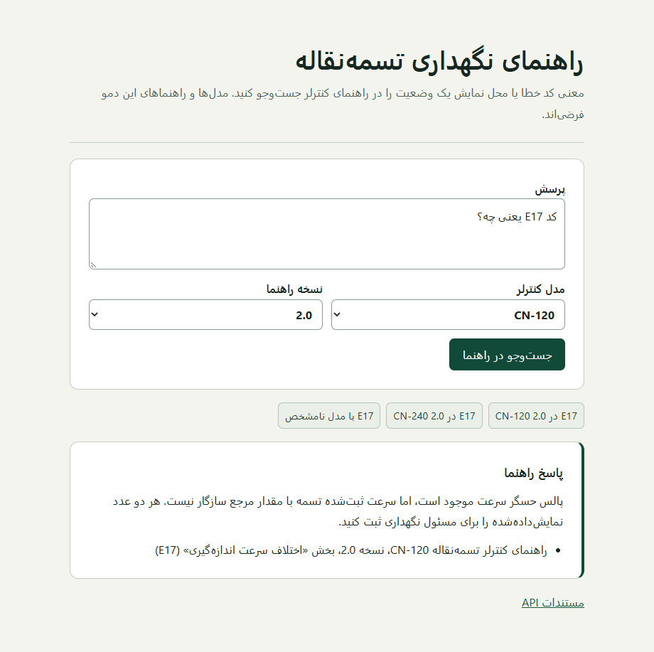

# Persian Maintenance RAG

Persian question answering for two fictional conveyor controllers, each with two manual revisions. The API shows the source model, revision, section, and manual excerpt. It asks for missing metadata when the manual interpretation changes and flags unsupported queries for human review.

سامانهٔ جست‌وجو در راهنمای فارسی دو کنترلر فرضی تسمه‌نقاله. برای نمونه، معنی `E17` را در هر دو مدل بپرسید و سپس همان پرسش را بدون مدل و نسخه بفرستید.

## Results

On the frozen 40-question challenge, **multilingual E5 hybrid retrieval handled 35 of 40 cases correctly (87.5%)**, up 20 percentage points from the initial release.

| Configuration | Correct grounded outcomes | Correctly answered among 20 answerable questions |
| --- | ---: | ---: |
| Initial rules | 27/40 (67.5%) | 10/20 |
| Updated rules | 31/40 (77.5%) | 11/20 |
| Updated rules + multilingual E5 | **35/40 (87.5%)** | **15/20** |

The E5 system also requested the correct missing fields in **7/7** clarification cases and abstained in **13/13** cases that required abstention. The five errors were abstentions on answerable questions. Warm in-process p95 latency was **10.93 ms** on an Intel Core i5-9400F. The challenge uses four fictional manuals authored for this project. [Evaluation rules, splits, and failures](docs/evaluation.md#frozen-40-question-challenge)

## Run the demo



Live demo capture using multilingual E5 hybrid retrieval. The query is for E17 on CN-120, revision 2.0, and the answer cites the matching fictional maintenance manual.

~~~sh
python -m pip install -r requirements.txt
python -m uvicorn app:app --host 127.0.0.1 --port 8000
~~~

Open the [Persian demo](http://127.0.0.1:8000/) or the [interactive API docs](http://127.0.0.1:8000/docs). The demo has three E17 example buttons. The first two send the same question about `CN-120` and `CN-240` at revision `2.0`. The third asks it without metadata.

| Request | Result |
| --- | --- |
| E17 on CN-120, 2.0 | The measured belt speed differs from the reference. |
| E17 on CN-240, 2.0 | The controller stopped receiving diagnostic messages from the output sensor. |
| E17 with no model or revision | Requests both fields. |
| E999 | Marks the question for human review. |

The quickstart uses lexical matching, Persian plural normalization, and a small alias dictionary. The API documents machine-readable statuses and evidence. [API contract](docs/api.md)

## Run multilingual E5 retrieval on CPU

The E5 mode adds a pretrained multilingual encoder and returns supporting excerpts through the same API and Persian demo.

With Python 3.14, install the optional dependencies and download the two pinned model files. Existing local copies under `models/` can be used directly.

```sh
python -m pip install -r requirements-e5.txt
hf download Xenova/multilingual-e5-small tokenizer.json onnx/model_int8.onnx --revision 761b726dd34fb83930e26aab4e9ac3899aa1fa78 --local-dir models/multilingual-e5-small
```

| File | SHA-256 |
| --- | --- |
| `tokenizer.json` | `0b44a9d7b51c3c62626640cda0e2c2f70fdacdc25bbbd68038369d14ebdf4c39` |
| `onnx/model_int8.onnx` | `4d24e2bc01a447951524466ef533e52944bf48509e6552810bcee1a2711cb02c` |

Set `E5_MODEL_DIR` to `models/multilingual-e5-small` and run Uvicorn as in the quickstart. In PowerShell, run `$env:E5_MODEL_DIR = 'models/multilingual-e5-small'`. In bash, run `export E5_MODEL_DIR=models/multilingual-e5-small`. Start the API with only one model configuration selected. The local model files are Git-ignored. [Model card](https://huggingface.co/intfloat/multilingual-e5-small) · [Pinned ONNX export](https://huggingface.co/Xenova/multilingual-e5-small/tree/761b726dd34fb83930e26aab4e9ac3899aa1fa78)

## Run the local model and pgvector

~~~sh
docker compose up --build
~~~

Compose starts PostgreSQL 16 with pgvector, pulls `embeddinggemma` and `qwen2.5:1.5b` inside Ollama, indexes the four manuals, and serves the same demo. The first run needs network access for the image and model downloads. PostgreSQL and Ollama stay inside the Compose network. The API is bound to localhost. [EmbeddingGemma](https://ollama.com/library/embeddinggemma) · [Qwen2.5 1.5B](https://ollama.com/library/qwen2.5:1.5b) · [pgvector](https://github.com/pgvector/pgvector)

To use an installed Ollama directly, start Ollama separately and pull both models.

~~~sh
ollama pull embeddinggemma
ollama pull qwen2.5:1.5b
~~~

Set `OLLAMA_URL=http://127.0.0.1:11434` in the API process environment. For PowerShell, run `$env:OLLAMA_URL = 'http://127.0.0.1:11434'`. Start Uvicorn as above. This mode keeps the 32 manual vectors in memory. Set `DATABASE_URL` and install `requirements-semantic.txt` to use a separate PostgreSQL instance. Run `python semantic.py` once to index the manuals before starting the API.

## How requests are answered

1. Normalize Persian and Arabic digits, Arabic forms of ی and ک, diacritics, and half-spaces. Resolve model and revision from request fields or the question.
2. Scope candidates by metadata. When the question names one code, match the exact error row. Compare its excerpt across admissible manuals and ask for the metadata that changes the result.
3. Flag recognized requests for undocumented procedures or numeric limits before interpreting a code. For prose, try lexical and normalized Persian term overlap. If that evidence is inconclusive, the E5 mode can fall back to the highest-scoring in-scope passage with a sufficient score and margin over other sections. The Ollama mode can select a shortlisted evidence ID or return an abstention. The API validates the ID and reproduces the source excerpt verbatim.

The corpus is four authored Markdown manuals with 32 sections and error rows. The demo uses local fictional data. A human-review flag is returned in the response for a caller to handle.

## Evaluation

~~~sh
python evaluate.py --split dev
python evaluate.py --split test
python evaluate.py --split hard-dev
python evaluate.py --split challenge --e5-model-dir models/multilingual-e5-small
docker compose exec api python evaluate.py --split test --semantic
~~~

The original benchmark contains 15 development queries and 45 test queries. The follow-up adds 12 harder development cases and a separate 40-question challenge with paraphrases, missing metadata, and unsupported requests that mention valid alarm codes. Use `--semantic` to add the Ollama result. [Metrics and failure examples](docs/evaluation.md) · [Labeled splits](evaluation/)

## Tests

~~~sh
python -m pip install -r requirements-dev.txt
python -m pytest -q
~~~

The tests cover the public API, allowed evidence IDs, the Ollama HTTP contract, and the benchmark labels. The pgvector integration test runs in GitHub Actions with a real PostgreSQL/pgvector service and a deterministic local Ollama HTTP fixture.
